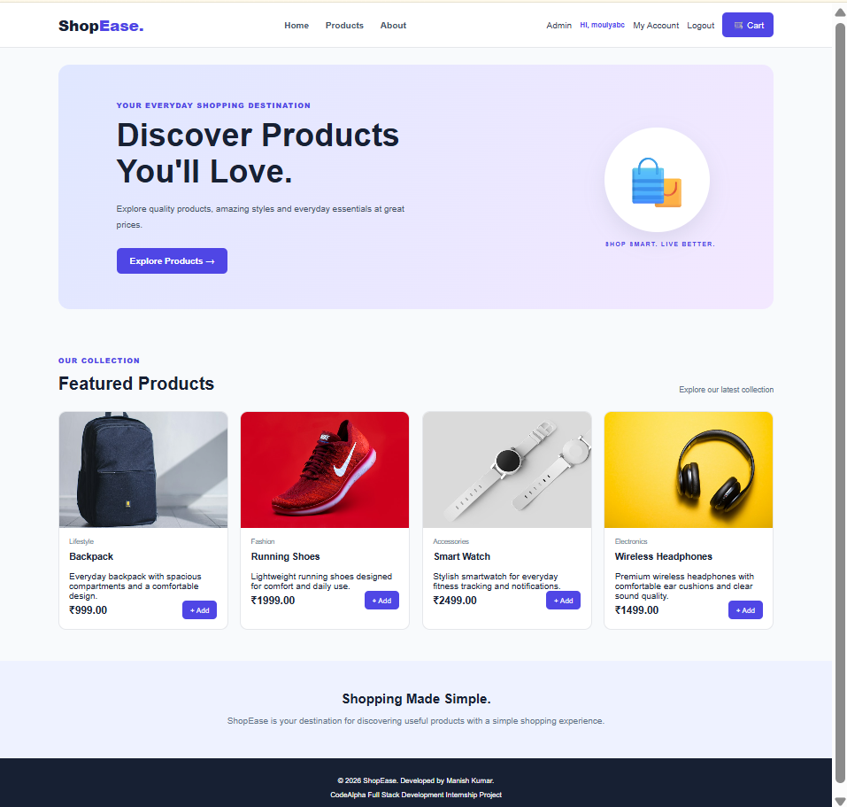
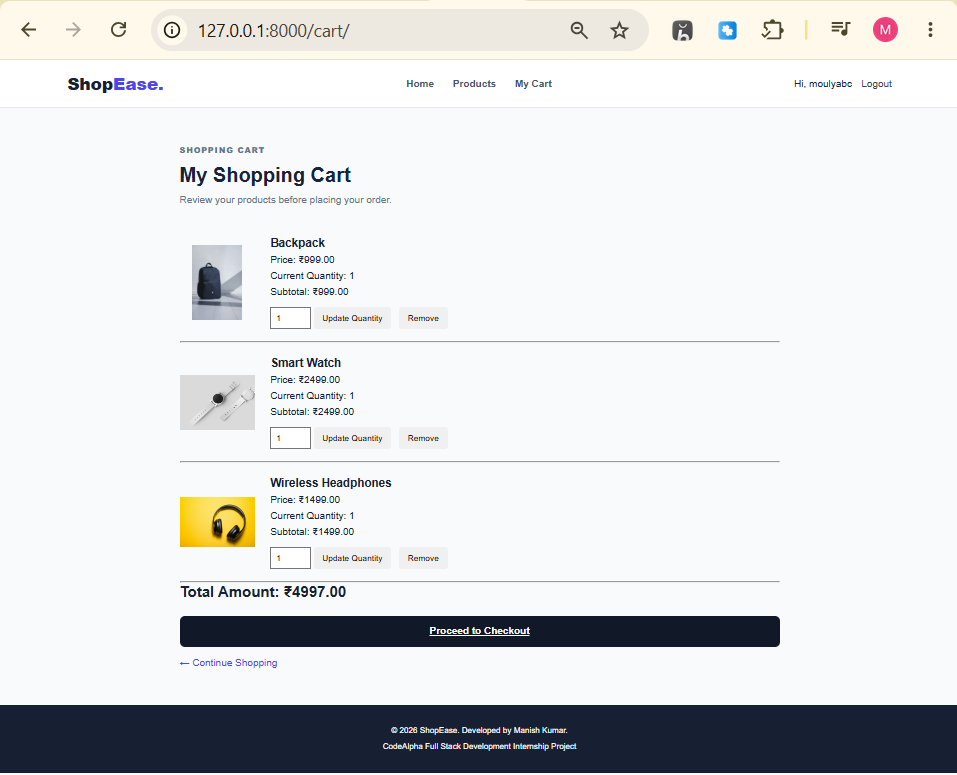
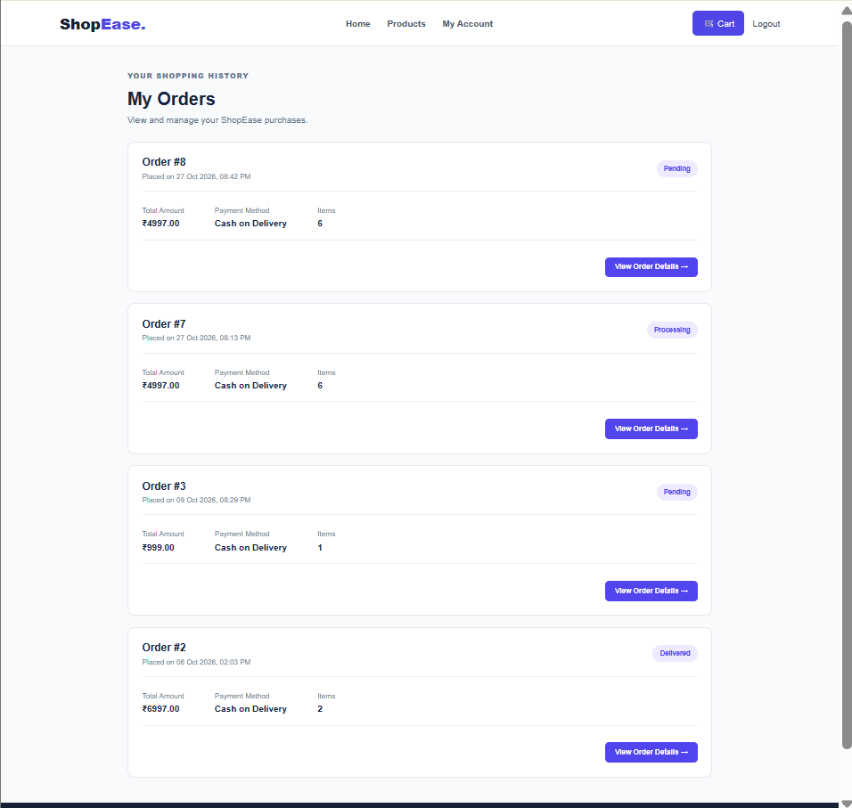

# ShopEase - E-Commerce Web Application

ShopEase is a Django-based e-commerce web application developed as part of the CodeAlpha Full Stack Development Internship.

## Features

- User registration and login
- Product browsing
- Shopping cart management
- Update product quantities and view subtotals
- Remove items from the cart
- Checkout and order placement
- Order history and order details
- Order status tracking
- Django admin panel for managing orders

## Technology Stack

- Python
- Django
- HTML
- CSS
- JavaScript
- SQLite (development database)

## Project Structure

```text
CodeAlpha_EcommerceStore/
├── config/
├── store/
├── manage.py
├── README.md
├── .gitignore
└── requirements.txt
```

## Installation and Setup

### 1. Clone the repository

```bash
git clone https://github.com/manish-kumar-dev-17/ShopEase.git
cd ShopEase
```

### 2. Create and activate a virtual environment

Windows PowerShell:

```powershell
python -m venv venv
.\venv\Scripts\Activate.ps1
```

### 3. Install dependencies

```bash
pip install -r requirements.txt
```

### 4. Configure environment variables

Create a `.env` file in the project root and configure the Django secret key according to the project's settings.

Do not commit your `.env` file or secret keys to GitHub.

### 5. Apply database migrations

```bash
python manage.py migrate
```

### 6. Start the development server

```bash
python manage.py runserver
```

Open http://127.0.0.1:8000/ in your browser.

## Security

- Keep secret keys in environment variables.
- Do not upload `.env`, database files, or virtual environments.
- `DEBUG=True` is intended for local development only.

## Author

Manish Kumar

GitHub: https://github.com/manish-kumar-dev-17


## Application Screenshots

### Homepage


### Shopping Cart


### Order History

